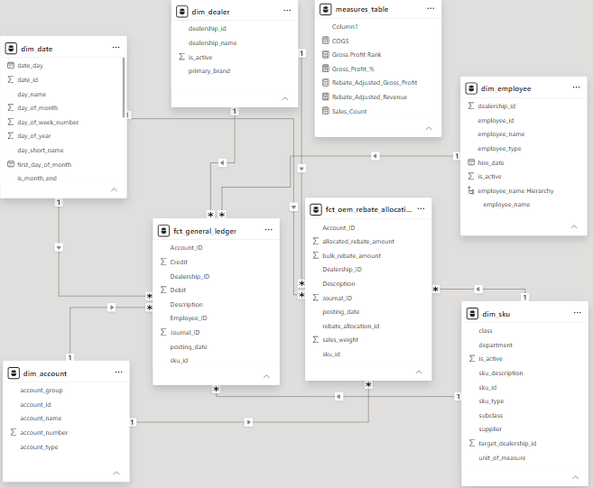
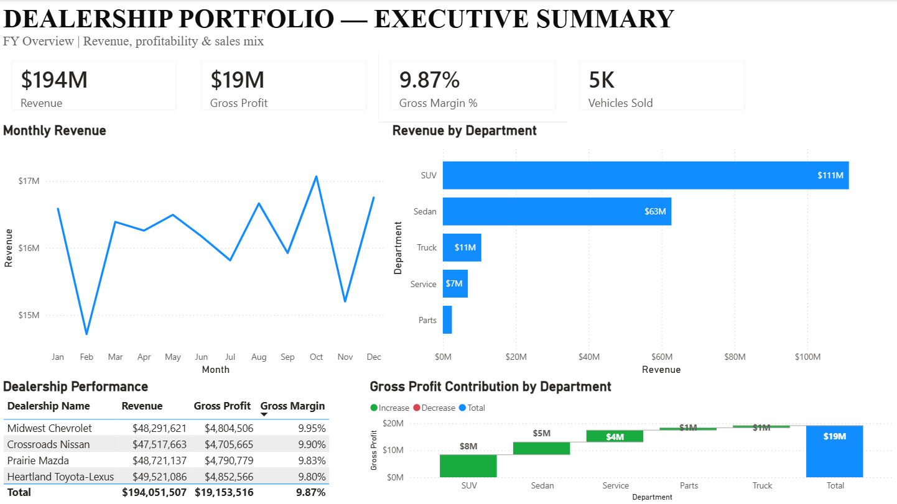
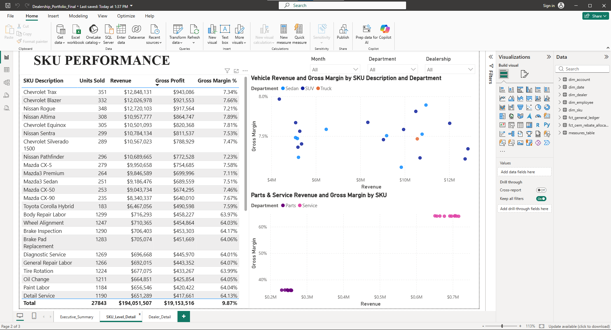
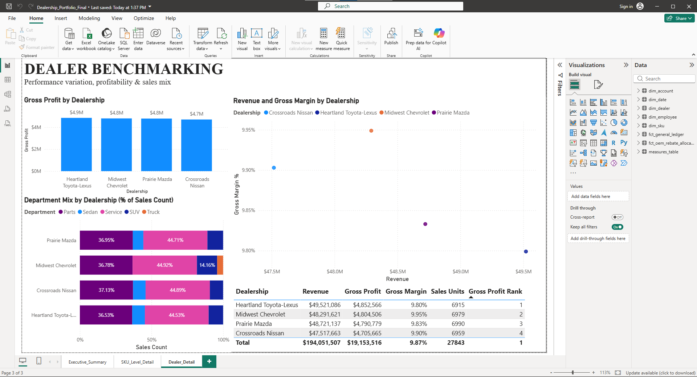

# Automotive Dealership Financial Analytics Portfolio

An end-to-end data analytics portfolio project built using Python, dbt, DuckDB, and Power BI to analyze multi-location automotive dealership data.

## Project Overview
This project simulates an enterprise General Ledger environment for a multi-location dealership group. It processes raw transactional data, transforms it through a structured analytics engineering pipeline, and powers an interactive executive dashboard. Includes an allocations table that splits bulk manufacturer rebates by a percentage of sales and a test to ensure that the amount being allocated equals the total of the bulk rebates. 

## Tech Stack
* **Data Generation:** Python (`generate_gl.py`)
* **Transformation:** dbt Core
* **Data Warehouse:** DuckDB
* **Visualization:** Power BI Desktop
* **Version Control:** Git & GitHub

## Project Structure
* `generate_gl.py`: A Python script that programmatically generates realistic double-entry General Ledger transactions.
* `models/staging/`: Normalizes raw tables into clean staging views with standard naming and data types.
* `models/marts/`: Builds final analytical dimension and fact tables (including General Ledger lines and rebate allocations).
* `seeds/`: Initial CSV reference files for accounts, dealers, employees, and SKUs.

## Dashboard Features
* **Executive Summary:** High-level revenue, gross profit, and monthly performance tracking.
* **SKU Performance:** Margin versus revenue analysis across vehicles, parts, and service departments.
* **Dealer Benchmarking:** Cross-location comparison of sales mix and profitability.

## How to Run Locally
1. Generate the raw dataset:
   ```bash
   python generate_gl.py  
   dbt seed
   dbt run
   dbt test

## Dashboard Screenshots

### Galaxy Schema


### Executive Summary


### SKU Performance


### Dealer Benchmarking
